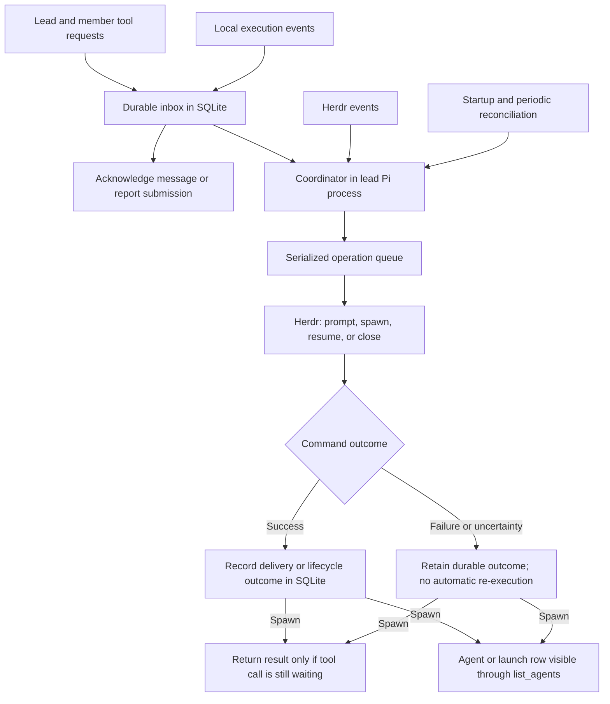

# Crew coordination rules

Status: Accepted.

## Glossary

- **Coordinator**: The lead-hosted authority for a crew tree's lifecycle commands, input delivery, and assignment settlement.
- **Inbox**: Pending operations persisted in SQLite, including their caller, recipient, and kind.
- **Settled turn**: A turn the runtime has finished with no pending tool execution, queued continuation, compaction work, or runtime retry. Its terminal outcome may be success, failure, or abort. An intermediate event, such as `agent_end`, does not establish a settled turn.

Submission acceptance and delivery follow [Crew communication rules](communication-rules.md#glossary). Assignments and settlement follow [Crew lifecycle rules](lifecycle-rules.md#assignment-tracking-and-recovery). Public arguments, results, and errors follow [Crew tool rules](tool-rules.md).

## Goal

Define coordination authority, durable processing, completion ordering, and recovery for the entire crew tree. Coordination may affect agent sessions only through the [session interaction allowlist](session-interaction-rules.md).

## Rules

### Ownership and hosting

- Each Herdr workspace has at most one active lead and one crew tree. Its coordinator runs in the lead's Pi process and is implemented in TypeScript. Separate workspaces have separate leads and coordinators.
- Serialize workspace-level lead claims. The first independent, non-member Pi session to acquire ownership through `/crew` or `--crew-mode lead` becomes the lead. Competing claims fail and leave the session inactive; command and menu behavior follows [Crew UX rules](ux-rules.md#crew-command).
- Lead ownership is exclusive until released; idle state or unreachability does not release it. Members never take over coordination.
- After release, a new independent Pi session may become coordinator and root lead. Atomically commit the transfer in the existing ledger before advertising the successor or processing work, without requiring lock deletion or resumption of the previous lead.
- Transfer root routing and direct-parent responsibilities to the successor. Preserve member sessions, nested relationships, record identities, assignments, task-name reservations, pending work, execution states, and process evidence. Do not drop, duplicate, or replay work.
- Fence released or superseded ownership instances from acting, including after restart, reload, resume, or a later claim by the same session. A previous lead session may acquire fresh ownership after the current lead releases it; both `A → B → C` and `A → B → A` are valid. Restart, reload, or resume must not restore a released ownership instance.
- The coordinator runs independently of the lead's model turns, including while idle.
- Every member records its root lead and immediate parent. Members run local adapters for tool requests, incoming input, and execution events; all submit operations to the root lead's coordinator.
- Only the coordinator issues Crew's Herdr launch, resume, prompt, and automatic close commands and records assignment settlement. Herdr owns process management.
- Routing through the lead preserves recorded relationships and permissions; a member's child still reports to that member.

### Connection observation and process supervision

- Reachability, process presence, activity, and assignment state are separate observations. An instance is connected when its Crew adapter responds with the matching session and instance identity. A failed probe establishes only unreachability.
- Record a durable OS process identity at startup or attachment and check that exact identity during recovery. It must distinguish PID reuse and remain meaningful across host restart; PID alone is insufficient. Reject startup or attachment readiness if reliable identity cannot be acquired or checked.
- Process checks distinguish alive, exited, and unknown. Failed inspection, adapter timeout, idle state, or absence from foreground-process listings does not prove exit. Unknown presence neither settles assignments nor permits resumption.
- Herdr events wake reconciliation; exact-instance OS evidence establishes exit. Periodic reconciliation recovers missed events. Events for an old instance must not establish exit of its replacement.
- Local observers may persist evidence while the lead is absent. Only the coordinator converts confirmed exit into decisions and outcomes under [termination and parent notification](lifecycle-rules.md#termination-and-parent-notification).
- Refresh observations on activation, resume, and observer reconnection, then periodically while Crew is active, including while idle or the lead is absent. Polling intervals and probe timeouts are implementation-defined.
- Keep one observer set per active runtime. Passes must not overlap or accumulate; concurrent manual refreshes join the in-flight pass. Probe independent adapters concurrently.
- Widgets and views consume these shared observations under [Crew UX rules](ux-rules.md#connected-agents-view), without separate polling loops. Observation may wake the coordinator but does not itself start turns, deliver input, or settle assignments.
- On shutdown, reload, or session replacement, stop timers and subscriptions, cancel probes, and dispose the old observers. Disposed observers must not update views or coordinator state. Restored observers reconcile current evidence before acting on missed events.

### Runtime storage

- Store all Crew-owned runtime state and configuration under `crew/` in Pi's resolved agent home directory (`$PI_CODING_AGENT_DIR`, default `~/.pi/agent`), including SQLite databases, sockets, recovery records, and layout configuration.
- Spawned members inherit the same resolved agent home directory.
- Pi-owned session files and agent definitions retain their locations; see [discovery and refresh](agent-frontmatter-rules.md#discovery-and-refresh).

### Conversation navigation and compaction

- SQLite is authoritative for Crew assignments and pending work. Conversation branches and transcript history are never a source of coordination state; settlement follows [assignment tracking and recovery](lifecycle-rules.md#assignment-tracking-and-recovery).
- Within the same Pi session, navigating to an older message or another branch changes only conversation context. It must not restore, roll back, replay, replace, resurrect, settle, or otherwise change coordination state. Pending assignments remain pending; settled assignments do not become outstanding again.
- Compaction changes only conversation context and has no special effect on assignments. Neither navigation nor compaction alone triggers reconciliation or outcome delivery; normal coordinator processing continues independently.
- This section does not define creation of a new session through a fork.

### Durable submission and local writes

- Tool handlers validate arguments, recorded relationships, and permissions, persist pending operations in SQLite, and notify the coordinator when available. The coordinator checks execution preconditions before acting.
- Members may persist requests, local progress, and execution events without the lead. The coordinator owns delivery records, assignment transitions, and lifecycle decisions.
- Give each request and event a stable identity. Repeated submission or recovery of the same record must not create another operation. New invocations and public retries follow [submission identity and retries](tool-rules.md#submission-identity-and-retries).
- Acknowledge `send_message` and `report_task` only after validated submission is durably persisted, whether or not the coordinator is available. Acknowledgement semantics follow [delivery and unavailable agents](communication-rules.md#delivery-and-unavailable-agents).
- Persistence failure returns an error, not an acknowledgement. Post-acceptance failures follow [delivery and execution recovery](#delivery-and-execution-recovery).
- `spawn_agent` waits for a recorded launch result under the following rules; persisting its request is not launch success.

### Synchronous spawn request/reply

- Lead and member handlers use the same path: atomically reserve the task name and persist a spawn request with an internal request ID and caller identity, then notify the coordinator through IPC. SQLite is authoritative; notifications only wake readers.
- Wait asynchronously for the durable result keyed by request ID without blocking the runtime's event loop or adapter. Check for a result when registering the waiter, periodically for missed notifications, and once more before declaring timeout.
- Launch through the coordinator's serialized queue. Establish launch success and the full Pi session ID through Herdr's launch/attachment path, then atomically record the child, parent relationship, initial assignment, and successful request result. Record confirmed failure or uncertainty against the same request.
- After committing the result, notify the caller's adapter. The handler reads SQLite and returns the [`spawn_agent` result or error](tool-rules.md#spawn_agent). This internal reply requires no model turn.
- An implementation-defined timeout bounds the wait, including during coordinator absence. Return `timeout` on expiry without cancelling the request, releasing its task name, or declaring launch failure.
- Return spawn results only through the waiting tool call. After timeout or caller disconnection, record the eventual outcome in SQLite without injecting a conversation message or starting a turn. Timeout/completion races must preserve the durable result without duplicating launch execution.
- Launch records and their eventual outcomes are visible under [`list_agents`](tool-rules.md#list_agents). Pending and uncertain launches retain enforceable task-name reservations.

### Inbox and coordinator

- Use one explicit serialized operation queue for input, completion decisions, reports, and lifecycle commands. A single-threaded event loop alone does not serialize asynchronous operations.
- Tool submissions, persisted local events, Herdr events, startup recovery, and periodic reconciliation enter the same coordinator. Notify it immediately of new input and events when available; periodic polling recovers missed notifications.
- For each executable operation, read pending input and agent state, select the permitted Herdr command, await its result, and record the outcome in SQLite before starting the next operation. Agent execution continues concurrently; the coordinator waits for command acceptance, not assignment completion or an answer.
- Leave operations awaiting unavailable recipients pending without blocking unrelated operations.
- An operation awaiting a command result is in progress. Reconciliation must not launch a competing operation or declare failure merely because success is not yet recorded.
- Messages and child outcomes use this queue while retaining their distinct [assignment effects](communication-rules.md#messages-and-assignments).

### Lead unavailability and recovery

- Lead absence pauses coordination for the whole tree, including communication between a connected member and its children. Local work, human control, and completion retention follow [lead or parent unavailability](lifecycle-rules.md#lead-or-parent-unavailability).
- On lead restart, reload, resume, or succession authorized under [ownership and hosting](#ownership-and-hosting), recover pending operations and events from SQLite, reconcile with Herdr, and continue the same crew tree.
- Operations with no execution attempt may proceed after recovery. In-progress, failed, and uncertain operations follow [delivery and execution recovery](#delivery-and-execution-recovery).
- Parent absence leaves reports pending for that recorded parent's reconnection, without reopening the parent or redirecting reports; see [delivery and unavailable agents](communication-rules.md#delivery-and-unavailable-agents).

### Completion and input ordering

- Persist each turn's terminal outcome with its session and turn identity. Record runtime-confirmed abortion and apply its [disruption effects](lifecycle-rules.md#disruption-while-the-agent-stays-open) before considering automatic completion. Authorize automatic completion only from a successful settled-turn event under the [eligibility and result-selection rules](lifecycle-rules.md#automatic-completion-eligibility-and-result-selection); non-aborted settlement alone is insufficient.
- Check durable pending input, outstanding child assignments, unprocessed child outcomes, and disruption before authorization.
- Serialize durable input submission against completion authorization. Include every submission accepted before authorization in the pending-input check, including after an outage. Deliver pending input first; prompt an idle child under the current assignment rather than reporting the previous turn's result.
- Persist local human input acceptance and turn activation, including during outages. Human turns need no coordinator activation. Completion checks and the race with local human input follow the accepted [non-interactive follow-up input rules](lifecycle-rules.md#non-interactive-follow-up-input): the check is best-effort, with no input gating or completion handshake.
- After authorization, finish reporting and settlement before processing further downward input for that child. Keep that input in the durable inbox and acknowledge submission normally, including during exit.
- Settle only the report's matching assignment under [assignment tracking and recovery](lifecycle-rules.md#assignment-tracking-and-recovery), then close an undisrupted non-interactive child through Herdr. Unavailable parents or failed report delivery leave the assignment unsettled and do not authorize closure or create a new assignment.
- Downward input processed after settlement starts a new assignment. If the prior instance is exiting, retain input until [process supervision](#connection-observation-and-process-supervision) confirms exit, then resume under the [resumption rules](lifecycle-rules.md#resumption). Never prompt the exiting instance.

### Delivery and execution recovery

- Select resumption commands under the [lifecycle resumption rules](lifecycle-rules.md#resumption). After a Herdr command succeeds, record delivery in SQLite. Success confirms only Herdr's command-acceptance guarantee, not model processing, an answer, or assignment settlement.
- Durably retain confirmed command failures and uncertain outcomes. Do not automatically retry or re-execute either. Reconciliation may collect evidence and record an established outcome; an unresolved operation remains blocked without blocking unrelated work. This contract provides no retry or manual re-execution mechanism for retained operations.
- Record failures discovered after acknowledgement with operation kind, resolved agent ID, error code, and cause under the [tool error contract](tool-rules.md#common-contract). Keep request identity internal for correlation and retain records across disconnection and coordinator restart. Recording failure does not inject a conversation message, start a turn, settle an assignment, or change lifecycle mode. Failure visibility follows [Crew tool rules](tool-rules.md#common-contract).
- Pending and uncertain launches retain task-name reservations. Reconcile the existing record before recording a child or releasing a name; never launch another instance to resolve uncertainty. Release after confirmed failure only under [submission identity and retries](tool-rules.md#submission-identity-and-retries).
- Coordinator or parent absence alone is not command failure: unattempted operations remain pending for automatic continuation after reconnection.
- A crash after command success but before SQLite recording may leave the outcome unknown. Stable identities prevent duplicate submission, not duplicate Herdr execution; never replay an uncertain operation.
- No separate Crew launch-receipt or process-management protocol on top of Herdr is required.

## Implementation verification

- Verify exclusive ownership across restart, reload, resume, succession, and concurrent claims. Cover both `A → B → C` and `A → B → A`, preserving the tree and durable work without replay. Reject stale writes from A's first ownership instance after A claims fresh ownership. Verify durable submissions and local events across outages.
- Verify spawn-result correlation, missed-notification checks, atomic child/result recording, and timeout/disconnection races without late message delivery. Herdr's launch/attachment path must establish the full session ID; command acceptance alone is insufficient.
- Verify serialized submission/completion ordering across processes and recovery, and the best-effort human-input check under the linked lifecycle rules.
- Verify each Herdr command's acceptance guarantee and evidence of parent receipt before recording assignment settlement.
- Verify settled-turn events include session, turn, and terminal outcome; test completion against the linked lifecycle eligibility and result-selection rules. Distinguish successful settlement, failure, and abortion using runtime evidence, not keyboard input. Verify abortion causes pane-lifetime disruption regardless of source under the current API limitation, while non-aborted failure preserves lifecycle mode.
- Verify exact-instance exit checks across missed events, PID reuse, and host restart; reject startup without reliable identity and block resumption on unknown presence.
- Verify shared observation passes, recovery refresh, and disposal. Disposed observers must produce no later updates.
- Verify navigation and compaction neither change durable coordination state nor trigger reconciliation or outcome delivery. Test both pending and settled assignments.
- Verify failed and uncertain operations are retained and never automatically re-executed or delivered as conversation messages; unrelated work must continue. Verify launch records remain visible through `list_agents` until successful recording replaces them with agent rows.